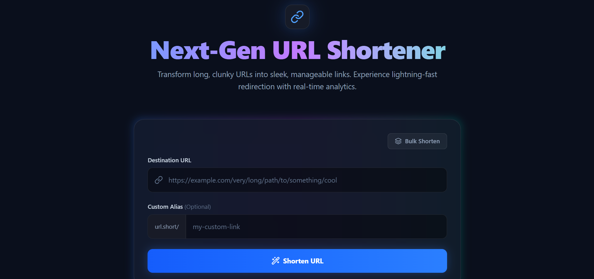

# SLiceURL - Full-Stack URL Shortener

Turn long, clunky URLs into short, shareable links. SnapLink supports custom aliases, bulk shortening, QR codes, click tracking and an analytics dashboard.

**Live demo:** https://slice-url-two.vercel.app

> The backend runs on a free hosting tier that sleeps when idle, so the first request after a break can take 30-60 seconds.

<!-- Add a screenshot: save it as docs/screenshot.png and uncomment the line below -->


---

## Features

- **URL shortening** with auto-generated 6-character slugs
- **Custom aliases** with duplicate detection and clear error messages
- **Bulk shortening** of up to 10 URLs at once, each with an optional alias
- **Click tracking**: every visit to a short link is counted before the redirect
- **QR codes** for any link, with PNG download
- **Delete links** with a confirmation prompt
- **Search and filter** by slug or original URL in real time
- **Analytics dashboard**: total links, total clicks, most clicked link and a top 5 bar chart
- **Share buttons** for WhatsApp and X/Twitter, plus copy to clipboard
- **Responsive dark UI** with a glassmorphism design

## Tech Stack

| Layer | Technologies |
|---|---|
| Frontend | React (Vite), Tailwind CSS v4, Axios, Recharts, lucide-react |
| Backend | Node.js, Express, Zod, nanoid, qrcode, cors, dotenv |
| Database | PostgreSQL on Neon, Prisma ORM v5 |
| Deployment | Vercel (frontend), Render (backend), Neon (database) |

## Architecture

```
React app (Vercel)
      |  HTTPS / Axios
      v
Express API (Render)
      |  Prisma ORM
      v
PostgreSQL (Neon)
```

## Project Structure

```
snaplink/
├── client/                 # React frontend
│   ├── src/
│   │   ├── App.jsx
│   │   └── index.css
│   └── package.json
└── server/                 # Express backend
    ├── prisma/
    │   └── schema.prisma
    ├── src/
    │   └── index.js
    └── package.json
```

## API Endpoints

| Method | Endpoint | Description |
|---|---|---|
| POST | `/api/shorten` | Create a short link. Body: `{ "url": "...", "slug": "optional" }` |
| GET | `/api/:slug` | Redirect to the original URL and count a click |
| GET | `/api/links` | List all links with click counts |
| GET | `/api/analytics` | Totals, most clicked link and top 5 links |
| GET | `/api/qr/:slug` | QR code for a link as a base64 PNG |
| DELETE | `/api/links/:slug` | Delete a link |

## Database Schema

```prisma
model Link {
  id        String    @id @default(cuid())
  slug      String    @unique
  url       String
  clicks    Int       @default(0)
  createdAt DateTime  @default(now())
  expiresAt DateTime?
}
```

---

## Getting Started

### Prerequisites

- Node.js 18 or later
- A PostgreSQL database (a free [Neon](https://neon.tech) project works well)

### 1. Clone the repository

```bash
git clone https://github.com/autbruba22it007/SliceURL
cd https://github.com/autbruba22it007/SliceURL.git
```

### 2. Set up the backend

```bash
cd server
npm install
```

Create `server/.env`:

```env
DATABASE_URL="your-postgresql-connection-string"
BASE_URL="http://localhost:5000"
PORT=5000
```

Create the table and start the server:

```bash
npx prisma db push
npm run dev
```

The API runs at `http://localhost:5000`.

### 3. Set up the frontend

Open a second terminal:

```bash
cd client
npm install
npm run dev
```

The app runs at `http://localhost:5173`. By default it talks to `http://localhost:5000/api`.

---

## Environment Variables

### Backend (`server/.env`)

| Variable | Description |
|---|---|
| `DATABASE_URL` | PostgreSQL connection string |
| `BASE_URL` | Public URL of the backend, without `/api` and without a trailing slash |
| `PORT` | Server port (hosting platforms usually set this for you) |

### Frontend (`client/.env`)

| Variable | Description |
|---|---|
| `VITE_API_URL` | Backend API address including `/api`, for example `https://your-backend.onrender.com/api` |

Never commit `.env` files. They are listed in `.gitignore`.

---

## Deployment

**Database (Neon):** create a project and copy the connection string.

**Backend (Render):**

- Root directory: `server`
- Build command: `npm install --include=dev && npx prisma generate`
- Start command: `npm start`
- Environment variables: `DATABASE_URL` and `BASE_URL` (your Render URL)

**Frontend (Vercel):**

- Root directory: `client`
- Environment variable: `VITE_API_URL` set to your backend URL ending in `/api`
- Redeploy after changing environment variables, because Vite reads them at build time

## What I Learned

- Designing a REST API with request validation using Zod
- Modelling data with Prisma and PostgreSQL
- How HTTP redirects work, and why a temporary redirect (302) lets every click be counted
- Managing environment variables across local, Vercel and Render setups
- Debugging production-only issues such as wrong API base URLs and Prisma client generation on deploy
- Migrating a backend between hosting providers without touching the database

## Roadmap

- [ ] Link expiration (the `expiresAt` field already exists)
- [ ] User accounts so each person manages their own links
- [ ] Password-protected links
- [ ] Custom domain
- [ ] Caching for faster redirects

## Author

**Isaac**

- GitHub: [@Isaac Bernods](https://github.com/autbruba22it007/SliceURL.git)
- LinkedIn: [Isaac Bernods](www.linkedin.com/in/isaac-bernods-4111a0371)
